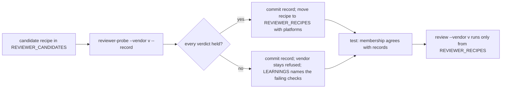

# Sandboxed reviewer recipes for Grok and Muse, and a spending ceiling for Claude reviews (issue #223)

## Summary

Give agent-launcher's headless reviewer launch a way to try a new vendor's sandbox recipe live before that vendor may review anything. Write candidate recipes for Grok and Muse, run `launcher.py reviewer-probe` on each, and let a vendor join `REVIEWER_RECIPES` only when every probe check held. A vendor that fails stays refused, and the failing check goes into the engineering journal. Separately, every Claude reviewer launch must carry a dollar ceiling, passed to `claude -p` as `--max-budget-usd`, and a Claude launch without one is refused.

---

## Problem Frame

This card is a prerequisite of K3, the reviewer bake-off in the saga review redesign (parent issue #147). K3's corpus harness measures review quality across vendors. Decision D1 of the program design (`docs/brainstorms/2026-10-05-saga-review-redesign/plan.md`, "The harness") fixed the contestants: Grok (`grok-4.7` at xhigh effort) and Muse (`muse-spark-1.3-contributor` at max effort), with Claude Opus as the baseline.

Two things block K3 today.

1. **Neither contestant can be launched as a reviewer.** `launcher.py review` starts saga's targeted reviewer headless, inside a vendor sandbox that keeps its commands in a scratch copy of the head commit, with no network and no credentials. `REVIEWER_RECIPES` (`plugins/agent-launcher/skills/agent-launcher/scripts/launcher.py:2632`) holds a recipe only for `claude`. Every other vendor is refused by name, because Codex's sandbox read a file outside its workspace on 2026-10-06. Worse, `reviewer_probe` (`launcher.py:3094`) calls `reviewer_recipe(vendor)` first, so the probe cannot even try a vendor that has no recipe yet. There is no path from "untested" to "proven".
2. **Claude reviews have no spending limit.** `reviewer_claude_argv` (`launcher.py:2306`) never passes `--max-budget-usd`. K3's harness requires a ceiling on every Claude launch.

Planning read each vendor CLI's own help and documentation on 2026-10-11. These facts shape the design; the build re-reads them on its own date, as the card requires.

- **Grok 1.0.50** has `--sandbox <PROFILE>`. Its own sandbox guide (shipped under the Grok home directory as `docs/user-guide/18-sandbox.md`) says the built-in `strict` profile still reads the Grok home directory (which holds its sign-in file) and still writes to `/tmp` and `/var/tmp`. It also says that blocking child-process network "is enforced on Linux only; on macOS it is a no-op". Custom profiles live only in a user-level or project-level `sandbox.toml`. The `GROK_CONFIG` overlay cannot carry one. Headless mode does not read the prompt from standard input; it takes `--prompt-file`. Its `--output-format json` result carries `text`, `usage`, `modelUsage` and `total_cost_usd`.
- **Muse 1.4.4** runs headless as `muse exec`. Its sandbox and approvals are on by default. It has `--sandbox-network restricted|enabled|proxy-only` (default `proxy-only`), `--permission-profile <ID>`, `--disable-web-tools`, `--prompt-file` and `--json` (JSONL events). The `muse` command on the path is a launcher script that updates the real binary in the background. Its default permission profile is a per-user setting, and it may be unrestricted.
- **Claude Code 2.1.296** documents `--max-budget-usd <amount>`: "Maximum dollar amount to spend on API calls (only works with --print)".

The most likely result, stated now so nobody mistakes it for a defect later: Grok fails the probe's network check on macOS, because its own documentation says it does not block child network there. The plan handles that outcome exactly as it handles a pass.

---

## Requirements

**Trying a vendor before it may review**

- R1. `launcher.py reviewer-probe --vendor <v>` runs a *candidate* recipe for Grok and for Muse. `launcher.py review` never runs a candidate: a vendor reviews only from `REVIEWER_RECIPES`, and is otherwise refused by name, as today.
- R2. The probe checks, separately and live, that a read outside the copy, a write outside the copy and the network are each denied. It also checks that the session gave an answer the recipe's own parser can read. The existing thirteen checks stay as they are; none is relaxed.
- R3. The probe also checks that the vendor's own sign-in files cannot be read by a sandboxed command. Verdicts come from exit codes only; file contents go to `/dev/null` and are never printed, logged or recorded.
- R4. The probe can write a record of its run: vendor, vendor version, platform, date, model, the sign-in path it used, and every verdict. The record carries no path, host, or credential.

**Candidate recipes for Grok and Muse**

- R5. Each candidate recipe builds its argv from that CLI's `--help` read on the build date, and never passes a flag or value listed for that vendor in `REVIEWER_FORBIDDEN_FLAGS`.
- R6. Each candidate recipe removes that vendor's API-key variables from the session environment, so the session signs in with the operator's subscription. Claude's list of removed variables is unchanged.
- R7. Each candidate recipe withholds from the scratch copy the project files that vendor would act on outside its sandbox, keeps sandboxed commands to the same environment allow-list Claude's recipe uses, and reads the review packet.
- R8. Each candidate recipe parses its vendor's real output into the same shape Claude's parser returns: usage, resolved models, final message, error.

**Promotion and refusal**

- R9. A vendor joins `REVIEWER_RECIPES` only with a committed probe record whose every verdict held. A test keeps membership and the records in agreement, so both outcomes are pinned.
- R10. A promoted Grok or Muse recipe names the platforms its probe passed on, and `review` refuses that vendor on any other platform. The Claude recipe names none, so its behaviour is unchanged.
- R11. A vendor that fails stays refused. Its failing checks, with the evidence, are recorded in `docs/engineering-journal/LEARNINGS.md`.

**Claude's spending ceiling**

- R12. `launcher.py review` takes `--max-budget-usd <amount>`. For `claude` it is required; a launch without it, or with an amount that is not a positive number, is refused (exit 2) before anything is created.
- R13. The ceiling reaches `claude -p` as `--max-budget-usd <amount>`, and `result.json` records it as `ceiling_usd`.
- R14. For a vendor whose CLI has no dollar ceiling, passing `--max-budget-usd` is refused rather than ignored.
- R15. The probe's own Claude launch carries a fixed ceiling, so every Claude reviewer launch, probe included, has one.

**Claude unchanged**

- R16. Apart from the two ceiling tokens, the Claude recipe's argv, settings, session environment, withheld files, configuration fingerprint and result parser are unchanged, and a test pins them.

**Documentation**

- R17. The agent-launcher skill documents the reviewer launch, the ceiling and the probe-then-promote rule; the changelog and the journal record the change.

---

## Key Technical Decisions

- KTD1. Candidates live in their own table, `REVIEWER_CANDIDATES`, beside `REVIEWER_RECIPES`: the probe looks in both, `review` looks only in `REVIEWER_RECIPES`. Rejected: adding Grok and Muse to `REVIEWER_RECIPES` and then probing. That would let `review` run an unproven sandbox for as long as the probe hasn't run. Also rejected: probing by hand outside the launcher, because then the recipe that ships would not be the recipe that was probed.
- KTD2. Promotion is a code change backed by a committed probe record, never a runtime switch. A probe on one machine must not silently change what every machine runs, and untracked state does not survive a worktree. The records live in `plugins/agent-launcher/tests/fixtures/reviewer-probe/<vendor>.json`. A test asserts that a vendor is in `REVIEWER_RECIPES` exactly when its record shows every verdict held, and that the recipe's platforms equal the record's platform.
- KTD3. A promoted Grok or Muse recipe carries `platforms`, the platforms its live probe passed on, and `review` refuses elsewhere. Grok's own documentation says its network denial and its deny globs behave differently on Linux and macOS, so a pass on one says nothing about the other. Claude's recipe sets `platforms=None` (any platform), so Claude behaves as it does today. Rejected: one recipe for every platform on the strength of a single-platform probe.
- KTD4. The ceiling is a `launcher.py review` flag named after Claude's own, `--max-budget-usd`. It is required for `claude`, and refused for a vendor whose recipe declares no dollar ceiling. The value must be a positive decimal with at most two places, and passes through unchanged. Rejected: a default ceiling, because a default would hide the K3 harness forgetting to set one, which is what the card exists to prevent. Also rejected: accepting and ignoring the flag for Grok or Muse, because a ceiling that silently does nothing is worse than a refusal.
- KTD5. The probe's Claude launch passes a fixed ceiling, `REVIEWER_PROBE_CEILING_USD = "1.00"`. The probe asks for one shell command on a small model, so a dollar never binds on a normal run but still bounds a runaway. `reviewer-probe --max-budget-usd` overrides it, which the build uses once to measure whether the ceiling is enforced under subscription sign-in.
- KTD6. Variation between vendors goes into fields on `ReviewerRecipe`, not into `if vendor ==` branches in the launch. The new fields are: API-key variables to remove; untrusted project names to withhold; how the prompt is delivered (standard input or a prompt file); the vendor's own sign-in files for the R3 check; the probe's default model; platforms; whether it takes a dollar ceiling; and an optional widening check. Claude's values reproduce today's constants exactly. Rejected: one shared union of every vendor's names. That would change what Claude's copy withholds and which variables Claude's session loses, and AC-3 requires Claude unchanged.
- KTD7. Grok's confinement is a custom sandbox profile that extends `strict`. The launcher writes it to `.grok/sandbox.toml` inside the copy, after it has withheld the reviewed change's own `.grok/`. The profile gets a random per-launch name, so a user profile of the same name cannot shadow it. It sets `restrict_network = true`, grants the packet and the toolchain parts read-only, and denies the temp roots and Grok's own sign-in file. Sandboxed commands get Claude's environment allow-list through the `GROK_CONFIG` overlay's `shell_environment_policy`, which that overlay is allowed to set. Rejected: editing the operator's own user-level `sandbox.toml` (the launcher never writes operator configuration); and relocating the Grok home directory (that loses the subscription sign-in and the operator's normal configuration). If Grok ignores a project-level profile in an untrusted directory, there is no fallback, and Grok stays refused.
- KTD8. Muse runs as `muse exec` with its default sandbox. The recipe passes `--sandbox-network restricted`, `--disable-web-tools`, an explicit `--permission-profile` (a user's default profile may be unrestricted), `--prompt-file` and `--json`. It never passes `--yolo`, `--disable-sandbox`, `--approval-mode never` or `--trust-workspace`.
- KTD9. No recipe passes a test by narrowing what the probe exercises. Two examples of what that rules out: a permission rule that denies `curl` by name, and a recipe that drops the Python test. The probe's commands stand for any command a hostile change could run. A recipe that holds only because one named tool is blocked has not denied the network. This is the card's rule "never relax a probe check" applied to the recipe side.
- KTD10. `REVIEWER_FORBIDDEN_FLAGS` may only grow. The build re-reads both CLIs' help and adds any flag that matches the table's own definition but is missing from it ("turn off instruction files, plugins, hooks or skills, or remove its sandbox or approvals"). Muse's `--disable-approval` is one; Muse's `--trust-workspace` (loads the reviewed change's own rules and skills) is another. The build never removes an entry.

---

## High-Level Technical Design

One path takes a vendor from untested to reviewing, and the same live probe decides both outcomes.



The probe's added checks sit beside the thirteen it already makes:

| Check | Held when | Proves |
|---|---|---|
| `answer-parsed` | the recipe's parser returns a final message and no error | the session ran, signed in, and answered |
| `read-vendor-credential` | each of the recipe's sign-in files that exists cannot be read by a sandboxed command; a file that does not exist is reported as absent | the vendor's own sign-in token is outside the reviewer's reach |

---

## Implementation Units

### U1. Claude reviews carry a required spending ceiling

Every Claude reviewer launch passes `--max-budget-usd`, and a Claude launch without one is refused.

**Goal:** add the ceiling to `launcher.py review` and to the probe's Claude launch, without changing anything else Claude does.

**Requirements:** R12, R13, R14, R15, R16.

**Dependencies:** none.

**Files:**
- `plugins/agent-launcher/skills/agent-launcher/scripts/launcher.py` (`ReviewerRequest`, `reviewer_launch`, `reviewer_claude_argv`, `reviewer_probe`, `_reviewer_args`, `_reviewer_cli`)
- `plugins/agent-launcher/tests/test_launcher_reviewer.py` (new)
- `plugins/agent-launcher/tests/test_launcher_contract.py` (the pinned Claude argv test and the recipe-argv test take the new keyword)

**Approach:**
- `ReviewerRequest` gains `max_budget_usd: str | None = None`. `reviewer_launch` validates it right after `reviewer_recipe(...)`, before it reads the prompt or creates anything. If the recipe takes a ceiling and none was given, it raises `ReviewerRefused`, with a message naming `--max-budget-usd`. It also refuses an amount that is not a positive decimal with at most two places, and any ceiling given for a recipe that takes none.
- `reviewer_claude_argv(model, effort, settings_path, *, max_budget_usd)` appends `--max-budget-usd <amount>` after `--no-session-persistence`. With no amount it raises, so no caller can build a Claude argv without one.
- `result.json` gains `ceiling_usd` (the string given, or `null` for a vendor without one). This is an additive key in the existing `targeted_reviewer_launch.v1` result.
- `reviewer_probe` passes `REVIEWER_PROBE_CEILING_USD` to a recipe that takes a ceiling. `reviewer-probe` gains an optional `--max-budget-usd` that overrides it.
- One live measurement, recorded in the journal by U5: run the Claude probe once with a ceiling far below one turn's cost, and note whether `claude -p` stops on it under subscription sign-in. If it does not stop, the flag is still passed, and the journal says plainly that the ceiling was not enforced.

**Patterns to follow:** the existing refusals in `reviewer_launch` (`launcher.py:2907-2938`), which all raise `ReviewerRefused` before any directory is created; the canned-session tests (`FakeSession`) in `plugins/agent-launcher/tests/test_launcher_contract.py`.

**Test scenarios:**
- Happy path: a Claude launch with `max_budget_usd="5"` and a fake session writes `result.json` with `ceiling_usd: "5"`. The argv the fake session received ends in `--max-budget-usd 5`.
- Error path: a Claude launch with no ceiling raises `ReviewerRefused` naming `--max-budget-usd`, and no work root, copy or `--out` directory exists afterwards.
- Error path: the amounts `0`, `-1`, `abc`, `1e3`, `nan` and `1.234` are each refused before anything is created.
- Error path, through the real script as a user runs it: `launcher.py review --vendor claude ...` with every other required flag but no `--max-budget-usd` exits 2 and prints the refusal on stderr.
- Error path: a ceiling given for a recipe that takes none is refused. This uses a test-only recipe whose ceiling field is false; there is no need to wait for U3.
- Edge case: `reviewer_claude_argv` called with no amount raises.
- Integration: `reviewer_probe("claude", "haiku", session=fake)` passes `--max-budget-usd 1.00` to the session; with an override it passes the override.
- Unchanged: the argv with the two ceiling tokens removed equals the argv pinned before this change, for every combination of effort given and effort omitted.

**Verification:** a Claude review cannot start without a ceiling; with one, the ceiling is in the argv and in the result; every other part of the Claude argv is identical to before.

**Functional checks:**

```functional-checks
- name: claude-ceiling-required
  command: python3 -m pytest plugins/agent-launcher/tests/test_launcher_reviewer.py -q -k ceiling
  proves: [AC-2]
  runs: local
- name: claude-reviewer-contract-still-passes
  command: python3 -m pytest plugins/agent-launcher/tests/test_launcher_contract.py -q --import-mode=importlib -k reviewer
  proves: [AC-3]
  runs: local
```

### U2. Recipe fields, candidates, and a probe that can try them

Recipes describe how they differ by vendor, and the probe can run a candidate that `review` never will.

**Goal:** give `ReviewerRecipe` the fields KTD6 names; add `REVIEWER_CANDIDATES`; add the probe's two checks and its `--record` output; keep Claude's behaviour identical.

**Requirements:** R1, R2, R3, R4, R6, R10, R16.

**Dependencies:** U1, because both change the argv signature.

**Files:**
- `plugins/agent-launcher/skills/agent-launcher/scripts/launcher.py`
- `plugins/agent-launcher/tests/test_launcher_reviewer.py`
- `plugins/agent-launcher/tests/test_launcher_contract.py` (the refused-by-name test is parametrised from the tables instead of a hard-coded vendor list)

**Approach:**
- `ReviewerRecipe` gains these fields:
  - `api_key_variables` and `api_key_prefixes`. Claude's are today's `REVIEWER_API_KEY_VARIABLES` and `REVIEWER_API_KEY_PREFIXES`.
  - `untrusted_dirs`, `untrusted_files` and `instruction_names`. Claude's are today's three constants. `reviewer_withhold_untrusted` takes them as arguments, with Claude's as the defaults.
  - `prompt_via`: `"stdin"` for Claude; `"file"` writes the message to a launcher-owned directory outside the copy and passes it by path.
  - `credential_files`, for the R3 check. Claude's: `~/.claude/.credentials.json`.
  - `probe_model`. Claude's: `haiku`, today's default.
  - `platforms`. Claude's: `None`.
  - `takes_ceiling`. Claude's: true.
  - `widening`. Claude's: `reviewer_claude_widening`; otherwise `None`.
- `reviewer_session_environment(env, recipe=...)` removes the recipe's variables. Called with Claude's recipe, its output is byte-for-byte what it is today.
- `REVIEWER_CANDIDATES: dict[str, ReviewerRecipe]` starts empty here; U3 and U4 fill it. `reviewer_recipe(vendor)` is unchanged and looks only in `REVIEWER_RECIPES`. A new `reviewer_probe_recipe(vendor)` looks in `REVIEWER_RECIPES` and then `REVIEWER_CANDIDATES`, and raises the same by-name refusal for a vendor in neither (Codex, Agy, Qwen, OpenCode).
- `review` refuses a recipe whose `platforms` does not include `sys.platform`, with a message naming the platforms it was probed on.
- The probe script gains one line per sign-in file: `cat "<file>" > /dev/null 2>&1; echo "read_vendor_credential_<n>=$?"`. The launcher writes it only for files that exist, and records the absent ones as absent. The verdict `read-vendor-credential` holds when every present file's read exited non-zero.
- The verdict `answer-parsed` runs `recipe.parse(proc.stdout)` and holds when `final` is a non-empty string and `is_error` is false.
- `reviewer-probe --record <path>` writes `{schema: "reviewer_probe_record.v1", vendor, vendor_version, platform, date, model, effort, sign_in, verdicts}`. The `sign_in` value is `"subscription"` when the session answered with the recipe's API-key variables removed, else `"not established"`. Standard output stays the verdict list it is today. The probe's `--model` default comes from the recipe's `probe_model`.
- Add `reviewer_record_admits(record) -> bool`: true only when `verdicts` is non-empty and every one held. U3, U4 and the agreement test all use it.

**Patterns to follow:** `reviewer_probe_verdicts` (`launcher.py:3047`), which judges every check from the command's exit codes and the filesystem, never from the model's words; the recipe-wide test `test_reviewer_no_reviewer_recipe_turns_off_configuration_or_its_sandbox`.

**Test scenarios:**
- Unchanged: for Claude's recipe, `reviewer_session_environment`, `reviewer_withhold_untrusted` (on a fixture copy holding `.claude/`, `.mcp.json`, a risky `CLAUDE.md` and a `.grok/` directory), `reviewer_claude_settings` and `reviewer_parse_claude_result` give the same output they gave before this change. The `.grok/` directory is *not* withheld from Claude's copy.
- Happy path: `reviewer_probe_recipe("grok")` returns the candidate (with a test-registered candidate before U3 lands), while `reviewer_recipe("grok")` still raises `grok has no reviewer sandbox recipe`.
- Error path: `reviewer-probe --vendor codex` still exits 2 with the by-name refusal.
- Error path: a recipe with `platforms=("linux",)` is refused by `review` on `darwin`, before anything is created.
- Probe verdicts: a fake session whose output parses to a final message gives `answer-parsed` held; empty output, non-JSON output and an `is_error` result each give it not held.
- Probe verdicts: a results file with `read_vendor_credential_0=0` gives `read-vendor-credential` not held; `=1` gives held; a recipe whose sign-in file is absent reports it as absent and the check holds.
- Record: `--record` writes the schema above. The file contains no string beginning with the fake home, the work root, or `/Users/` or `/home/`, and no canary value.
- Admission: `reviewer_record_admits` is false for an empty verdict list, false when any verdict did not hold, and true only when all held.
- Every recipe in both tables: no argv token is in that vendor's `REVIEWER_FORBIDDEN_FLAGS` entry, and settings carry no `apiKeyHelper`, plugins or hooks key.

**Verification:** the probe can try a candidate, `review` cannot, and every Claude output is identical to before.

**Functional checks:**

```functional-checks
- name: candidates-probe-only-and-claude-unchanged
  command: python3 -m pytest plugins/agent-launcher/tests/test_launcher_reviewer.py -q -k "candidate or unchanged or forbidden or record or verdict"
  proves: [AC-1, AC-3]
  runs: local
```

### U3. Grok's candidate recipe, its live probe, and the decision

Write Grok's recipe from its own help, probe it live, and either promote it or keep it refused.

**Goal:** a `grok` entry in `REVIEWER_CANDIDATES`, a committed probe record, and Grok in `REVIEWER_RECIPES` only if that record shows a full pass.

**Requirements:** R5, R6, R7, R8, R9, R10, R11.

**Dependencies:** U2.

**Files:**
- `plugins/agent-launcher/skills/agent-launcher/scripts/launcher.py`
- `plugins/agent-launcher/tests/test_launcher_reviewer.py`
- `plugins/agent-launcher/tests/fixtures/reviewer-probe/grok.json` (new; the probe record)

**Approach:**
- Re-read `grok --help`, `grok agent --help` and Grok's sandbox, headless-mode, authentication and configuration guides on the build date. Record the version. Add any missing flag to `REVIEWER_FORBIDDEN_FLAGS["grok"]` under KTD10; for example, the sandbox values `off` and `devbox`.
- Argv: headless (`-p` with `--prompt-file`, per the headless guide), `-m <model>`, `--reasoning-effort <effort>`, `--sandbox <per-launch profile name>`, `--output-format json`, `--disable-web-search`, and a non-bypass `--permission-mode`. Choose the mode, and any `--allow` rule Bash needs, from the help and one measured run. The bar: Bash runs headless with no approval prompt, and without `--always-approve` or `bypassPermissions`.
- Settings: KTD7's profile, written into the copy's `.grok/sandbox.toml` after withholding the reviewed change's own `.grok/`. The profile denies the temp roots, Grok's own sign-in file and the R3 files. It grants read-only the packet, the prompt directory and the toolchain parts `reviewer_toolchain_paths` returns. Set `GROK_CONFIG` to an overlay whose `shell_environment_policy` keeps only `REVIEWER_ENVIRONMENT_ALLOWED` and drops credential-looking names.
- Untrusted names: run `grok inspect` in a scratch directory holding a sample of each project file Grok might discover. Withhold every one it reports as a hook, MCP server, rule or skill source. That is `.grok/` at least, and Claude-compatible sources such as `.claude/` and `.mcp.json` if Grok reports them.
- API-key variables: `XAI_API_KEY` and `GROK_DEPLOYMENT_KEY` (both named in Grok's guides), plus any others its authentication guide names on the build date.
- Parser: from one captured live `--output-format json` result. `final` comes from `text`, `resolved` from the keys of `modelUsage`, usage from `usage` plus `total_cost_usd`, and the error from a non-`end_turn` `stopReason`. The test fixture is that captured output with the session and request IDs replaced by inert values.
- Probe: `launcher.py reviewer-probe --vendor grok --record plugins/agent-launcher/tests/fixtures/reviewer-probe/grok.json`, with the model D1 names. Before committing the record, read it and confirm it holds no path, host or credential.
- Decision: if `reviewer_record_admits(record)`, move the recipe into `REVIEWER_RECIPES` with `platforms=(record["platform"],)`. If not, leave it as a candidate and stop. Card stop conditions: a sandbox escape, or a recipe that needs a forbidden flag to run at all, ends the unit with Grok refused and the evidence recorded. Neither is worked around.

**Patterns to follow:** `reviewer_claude_settings` (`launcher.py:2319`) for deriving the allowed reads; `reviewer_parse_claude_result` (`launcher.py:2371`) for the parser's return shape.

**Test scenarios:**
- Argv: the recipe's argv for `("grok-4.7", "xhigh", ...)` contains `--sandbox`, the prompt file, `--output-format json` and `--disable-web-search`. It contains no token from `REVIEWER_FORBIDDEN_FLAGS["grok"]` and no `--max-budget-usd`.
- Settings: the written profile extends `strict`, sets `restrict_network = true`, denies every temp root from `reviewer_temp_roots()` and the Grok sign-in file, grants the packet read-only, and has a name that differs between two launches.
- Environment: a session environment built from inert `XAI_API_KEY`, `GROK_DEPLOYMENT_KEY` and `HONCHO_WORKSPACE` values keeps only the last. The `GROK_CONFIG` overlay keeps exactly `REVIEWER_ENVIRONMENT_ALLOWED`.
- Withholding: a fixture copy with a `.grok/hooks/` directory and a `.grok/sandbox.toml` loses both before the launcher writes its own profile.
- Parser: the captured result gives the final text, the resolved model and the usage. Empty output, non-JSON output and a `max_tokens` stop reason each give an error.
- Outcome: a test reads `grok.json`. If `reviewer_record_admits` is true, Grok is in `REVIEWER_RECIPES` with the record's platform, and `review --vendor grok` with a fake session returns an answer. If false, `reviewer_recipe("grok")` raises the by-name refusal, and `launcher.py review --vendor grok` exits 2.

**Verification:** the committed record and the tables agree, and the record came from a live run on the build date.

**Functional checks:**

```functional-checks
- name: grok-recipe-contract
  command: python3 -m pytest plugins/agent-launcher/tests/test_launcher_reviewer.py -q -k grok
  proves: [AC-1, AC-3]
  runs: local
- name: grok-live-probe-agrees-with-tables
  command: sh -c 'r="$(mktemp -d)/grok.json"; python3 plugins/agent-launcher/skills/agent-launcher/scripts/launcher.py reviewer-probe --vendor grok --record "$r"; REVIEWER_PROBE_LIVE_RECORD="$r" python3 -m pytest plugins/agent-launcher/tests/test_launcher_reviewer.py -q -k live_probe_agrees'
  proves: [AC-1]
  runs: environment
```

The live check passes in both outcomes. It fails only when today's live probe disagrees with the committed tables. The probe's own exit code (1 on a failed check) is deliberately not the check's exit code. The `live_probe_agrees` test is skipped when `REVIEWER_PROBE_LIVE_RECORD` is unset, and fails when it is set but the file is missing.

### U4. Muse's candidate recipe, its live probe, and the decision

The same path as U3, for Muse.

**Goal:** a `muse` entry in `REVIEWER_CANDIDATES`, a committed probe record, and Muse in `REVIEWER_RECIPES` only on a full pass.

**Requirements:** R5, R6, R7, R8, R9, R10, R11.

**Dependencies:** U2. Independent of U3.

**Files:**
- `plugins/agent-launcher/skills/agent-launcher/scripts/launcher.py`
- `plugins/agent-launcher/tests/test_launcher_reviewer.py`
- `plugins/agent-launcher/tests/fixtures/reviewer-probe/muse.json` (new; the probe record)

**Approach:**
- Re-read `muse --help` and `muse exec --help` on the build date, and record the version. Add `--disable-approval` and `--trust-workspace` to `REVIEWER_FORBIDDEN_FLAGS["muse"]` (KTD10), plus anything else that matches the table's definition.
- Argv: `muse exec --model <model> --reasoning-effort <effort> --json --prompt-file <file> --sandbox-network restricted --disable-web-tools --permission-profile <profile> --no-session-log`. Choose the permission profile from Muse's documentation on the build date: the most restrictive built-in profile under which the probe's Python test and `git --version` still run. Choose the approval handling for an unattended run the same way, without `never` or `--disable-approval`. If shell commands cannot run unattended without one of those, that is the card's "needs a forbidden flag" stop condition.
- Settings: whatever per-run confinement `-c KEY=VALUE` or the permission profile can express, built from the same allowed reads as Claude's: the copy, the packet and the toolchain parts.
- Untrusted names: run `muse init --dry-run` in a scratch directory to learn which project files Muse creates and reads. Withhold those that could carry hooks, rules, skills or MCP servers. Without `--trust-workspace`, Muse should not load workspace skills or rules; withholding is defence in depth, and a test pins it.
- API-key variables and sign-in files: from Muse's own documentation and the `muse` launcher script on the build date. The sign-in file is `auth.json` under Muse's configuration directory. Never pass `--api-key-stdin`.
- Parser: from one captured live `--json` run. Take the final assistant message and the usage events. The fixture replaces session IDs with inert values.
- Version drift: the `muse` launcher script updates its binary in the background. The probe record and every `result.json` name the version that actually ran, read the same way `_reviewer_vendor_version` reads it today. The recipe does not pin or disable updates, because that would change the operator's normal configuration.
- Probe, decision and stop conditions: as in U3, with D1's model `muse-spark-1.3-contributor`.

**Patterns to follow:** U3; `reviewer_parse_claude_result` for the return shape.

**Test scenarios:**
- Argv: the recipe's argv for `("muse-spark-1.3-contributor", "max", ...)` starts `muse exec` and contains `--sandbox-network restricted`, `--disable-web-tools`, `--permission-profile` and the prompt file. It contains no token from `REVIEWER_FORBIDDEN_FLAGS["muse"]` (including `never`, `--yolo`, `--disable-sandbox`, `--disable-approval` and `--trust-workspace`) and no `--api-key-stdin` or `--max-budget-usd`.
- Environment: inert values for each Muse API-key variable are removed from the session environment; an ordinary variable is kept.
- Withholding: a fixture copy holding each Muse project file that `muse init --dry-run` names loses the ones that carry hooks, rules, skills or servers.
- Parser: the captured JSONL gives the final message, model and usage. Empty output, a stream with no final message, and an error event each give an error.
- Outcome: as in U3, read from `muse.json`.

**Verification:** as in U3.

**Functional checks:**

```functional-checks
- name: muse-recipe-contract
  command: python3 -m pytest plugins/agent-launcher/tests/test_launcher_reviewer.py -q -k muse
  proves: [AC-1, AC-3]
  runs: local
- name: muse-live-probe-agrees-with-tables
  command: sh -c 'r="$(mktemp -d)/muse.json"; python3 plugins/agent-launcher/skills/agent-launcher/scripts/launcher.py reviewer-probe --vendor muse --record "$r"; REVIEWER_PROBE_LIVE_RECORD="$r" python3 -m pytest plugins/agent-launcher/tests/test_launcher_reviewer.py -q -k live_probe_agrees'
  proves: [AC-1]
  runs: environment
```

### U5. Skill, changelog and journal

Document the probe-then-promote path and the ceiling, and record each vendor's outcome where the next reader will look.

**Goal:** the skill tells an operator how to start a reviewer and why a vendor may be refused; the journal holds the evidence; a test keeps the journal and the probe records in agreement.

**Requirements:** R11, R17.

**Dependencies:** U1, U3, U4.

**Files:**
- `plugins/agent-launcher/skills/agent-launcher/SKILL.md`
- `plugins/agent-launcher/CHANGELOG.md`
- `docs/engineering-journal/LEARNINGS.md`
- `plugins/agent-launcher/tests/test_launcher_reviewer.py`

**Approach:**
- `SKILL.md` gains a short "Headless reviewer" section. It covers `launcher.py review` and its required `--max-budget-usd` for Claude, which vendors have a recipe and on which platform, and how a vendor joins: write a candidate, run `reviewer-probe --record`, and promote only on a full pass. The skill names the probe's checks in plain words and links the journal entries.
- `CHANGELOG.md` under `[Unreleased]`, in two parts. Added: candidate recipes, the probe's two checks and `--record`, and per-platform recipes. Changed: a Claude review now requires `--max-budget-usd`, and a caller that does not pass one is refused.
- `LEARNINGS.md`, a dated `2026-10-11` (or build-date) entry per vendor with **Evidence**, **Mechanism** and **Generalizable rule**. Evidence names the vendor version, the platform, the date, and each check that held or failed with its detail line; there is no path, host or figure from a private repository. For a failing vendor, Mechanism names the cause where the vendor's own documentation states it (for example, Grok's guide: child network blocking is a no-op on macOS). One more entry records the ceiling measurement from U1.
- A test reads both probe records and `LEARNINGS.md`. For each vendor whose record does not admit, the journal must contain an entry that names `reviewer-probe --vendor <v>` and every failing check name.

**Patterns to follow:** the 2026-10-06 journal entry for issue #158 (the Codex sandbox read) and the issue #189 entry, which record probe evidence the same way.

**Test scenarios:**
- For each record that does not admit: `LEARNINGS.md` names the vendor's probe command and each failing check. Removing one check name from a copy of the journal text makes the test fail.
- For each record that admits: no assertion on the journal beyond the entry existing.
- `Test expectation` for the documentation itself: `scripts/check_repo.py` validates journal and changelog structure.

**Verification:** an operator reading the skill can start a Grok, Muse or Claude reviewer, or learn why one is refused, without reading the launcher.

**Functional checks:**

```functional-checks
- name: journal-names-failing-checks
  command: python3 -m pytest plugins/agent-launcher/tests/test_launcher_reviewer.py -q -k learnings
  proves: [AC-1]
  runs: local
```

---

## Scope Boundaries

**In scope:** the headless reviewer launch path in agent-launcher (`review` and `reviewer-probe`), the Grok and Muse candidate recipes, Claude's ceiling, and their tests and documentation.

**Non-goals (from the card):**
- Recipes for Codex, Agy, Qwen or OpenCode. They stay refused by name.
- Weakening the probe or the forbidden-flag table to let a vendor pass.
- The bake-off itself, which is K3's.
- Interactive Herdr sessions and their permission flags (`VENDOR_PERMISSIONS`), which this card does not touch.

**Deferred to follow-up work (later items, not units):**
- **Orchestrate's `review-launch` passes no ceiling.** `cmd_review_launch` (`plugins/orchestrate/skills/orchestrate/scripts/orchestrate.py:3920`) builds the `launcher.py review` argv with nine fixed flags, and its test pins exactly those nine (`plugins/orchestrate/tests/test_orchestrate_review_transport.py:700`). After this card merges, a live orchestrate review on a Claude seat will be refused with exit 2 until orchestrate passes `--max-budget-usd`. The card leaves orchestrate out of scope, and choosing where orchestrate's ceiling comes from (the staffing row, the run record, or a flag) is a decision of its own. Recommended priority: high. Land it before any live orchestrate review on Claude.
- Probing Grok and Muse on Linux, which would add Linux to a promoted recipe's platforms. A vendor refused on macOS may still pass there; Grok's guide says it blocks child network on Linux.
- Re-probing when a vendor's version changes. Today `result.json` records the version, but nothing compares it with the version that passed the probe. Saga's setup step (card C3) is the natural home.
- Spending limits for Grok and Muse reviews. Neither CLI offers a dollar ceiling. Grok has `--max-turns` and Muse has `--max-model-steps`, but a turn cap is not a dollar cap, and K3 asks only for Claude's.

---

## Risks & Dependencies

| Risk | Mitigation |
|---|---|
| A vendor's sandbox looks enforced but leaks a read outside the copy, as Codex's did. | The probe tests reads, writes and network separately and live. It also checks the vendor's own sign-in files. A vendor ships only on a full pass, and U3/U4 stop on any escape. |
| Stripping API-key variables breaks a vendor's subscription sign-in. | The probe's `answer-parsed` check fails and the record says `sign_in: not established`. The vendor stays refused, with that recorded. |
| The vendor's own sandbox also blocks the vendor process from reading its sign-in file (Grok's sandbox covers the whole process). | Measured by the probe. If denying the sign-in file to commands also stops sign-in, Grok fails `answer-parsed` or `read-vendor-credential`, and stays refused. Allowing the file back to make it run is not an option. |
| Grok ignores a project-level `sandbox.toml` in an untrusted directory. | The probe's checks fail under the bare `strict` profile (temp writes and the Grok home stay open), so Grok stays refused. There is no fallback that writes operator configuration. |
| Muse updates itself between the probe and a review. | Every result names the version that ran. Re-probing on version change is a later item. |
| Orchestrate's Claude review-launch is refused once the ceiling is required. | Named as the first later item, to land before any live orchestrate review on Claude. |
| Probe records or journal entries leak a path, host or credential into this public repository. | The record carries verdict lines and versions only. A U2 test rejects home-like and work-root paths in a record. The builder reads every record before committing it. |

---

## Scenario Smoke

On the combined branch, on the operator's Mac: the Claude probe through the real `claude -p` launch (now carrying its ceiling), then the card's verification commands.

```scenario-smoke
- name: live-claude-probe-with-ceiling
  command: python3 plugins/agent-launcher/skills/agent-launcher/scripts/launcher.py reviewer-probe --vendor claude --model haiku
  proves: [AC-2, AC-3]
  runs: environment
- name: card-verification
  command: sh -c 'python3 -m pytest plugins/agent-launcher/tests/test_launcher_reviewer.py && python3 -m pytest plugins/agent-launcher/tests -q --import-mode=importlib && python3 scripts/check_repo.py && python3 -m unittest discover -s tests && git diff --check'
  proves: [AC-1, AC-2, AC-3]
  runs: environment
```

---

## Sources / Research

- Issue #223 (this card). Its body reproduces the source brainstorm `docs/brainstorms/2026-10-11-reviewer-recipes-grok-muse/enhancement.md` in full.
- `docs/brainstorms/2026-10-05-saga-review-redesign/plan.md`, "The harness" (decision D1: the Grok, Muse and Claude bake-off).
- `plugins/agent-launcher/skills/agent-launcher/scripts/launcher.py`:
  - `:2053`, `REVIEWER_FORBIDDEN_FLAGS`;
  - `:2075`, the API-key variables;
  - `:2092`, the environment allow-list;
  - `:2207`, the session environment;
  - `:2306`, `reviewer_claude_argv`;
  - `:2319`, `reviewer_claude_settings`;
  - `:2371`, the Claude parser;
  - `:2619-2641`, `ReviewerRecipe` and `REVIEWER_RECIPES`;
  - `:2907`, `reviewer_launch`;
  - `:3014-3152`, the probe;
  - `:3155`, the CLI.
- `plugins/agent-launcher/tests/test_launcher_contract.py:4835-4875`, the existing forbidden-flag, API-key and refused-by-name tests.
- `plugins/orchestrate/skills/orchestrate/scripts/orchestrate.py:3920` (`cmd_review_launch`), the one caller of `launcher.py review`.
- Vendor documentation read on 2026-10-11: `claude --help` (2.1.296); `grok --help`, `grok agent --help` and Grok's user guides on sandbox, headless mode and configuration (1.0.50); `muse --help` and `muse exec --help` (1.4.4).
- `docs/engineering-journal/LEARNINGS.md`, the 2026-10-06 entries for issues #158 and #189 (the Codex read leak, and the Claude probe evidence).
